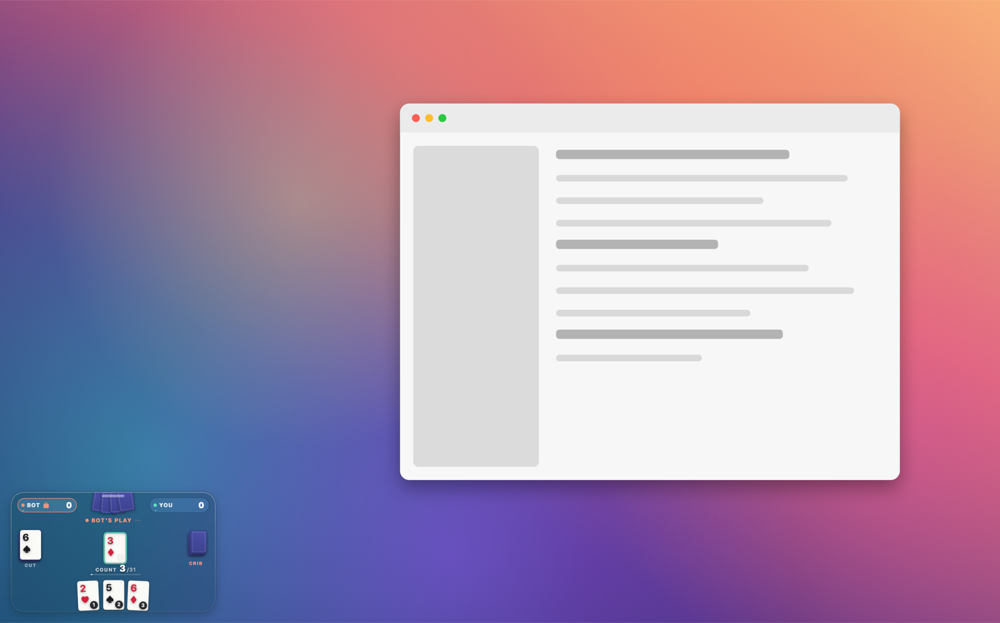

# tiny-crib

A tiny cribbage game that runs in a tiny window in the bottom left corner of your Mac desktop. Meant to be played fully through the keyboard so you can rip crib games as fast as humanly possible. Crib speedruns are the new meta.

haven't signed the release so you will have to take my word that i didnt added a keylogger 😈

## Controls

| Key | Does |
| --- | --- |
| ⌃⌥H | Hide or show the game |
| ⌃⌥C | Focus the game |
| 1–6 | To select cards |
| B | Show or hide the crib board |
| ⏎ | Send the picked cards to the crib, step through the counting, start the next hand |
| ⌘N | New game |
| ⌘H | Hide the overlay while it's focused |
| ⌘Q | Quit |
| Esc | Hand focus back to the app you were in |
| Click | You can use your mouse as well |

You can also use a drag handle at the top of the crib window to move it around your desktop as well.

## Gameplay

